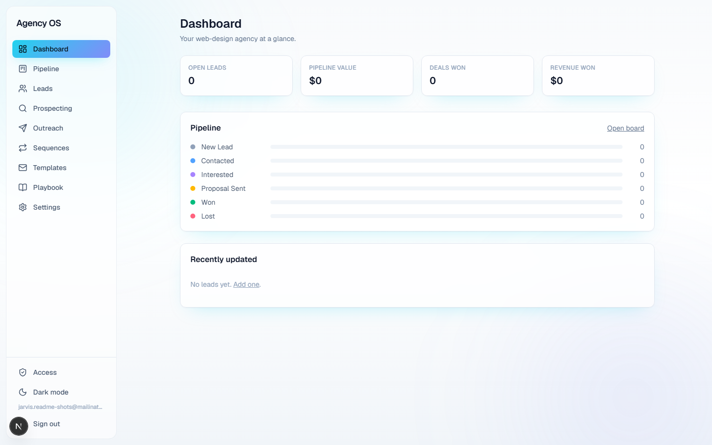
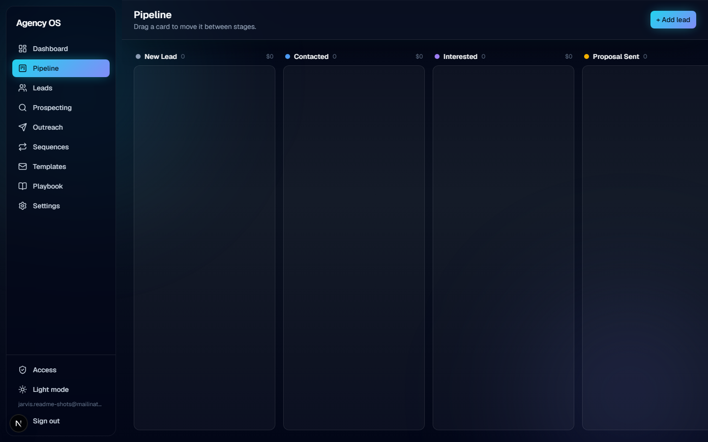
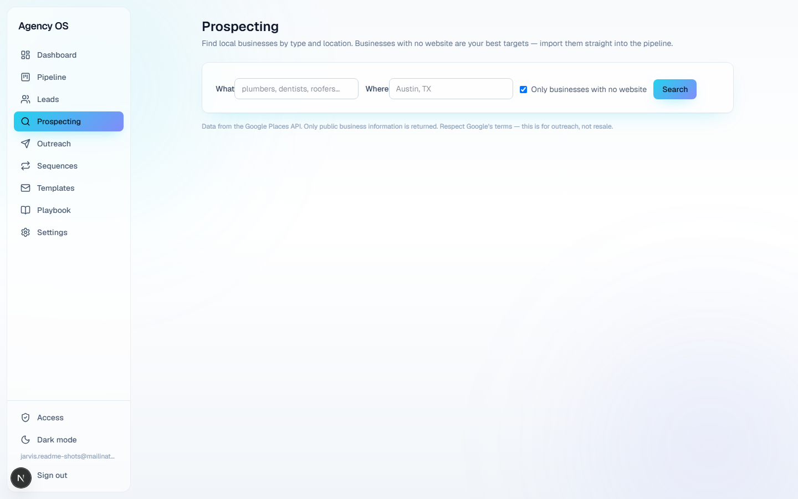
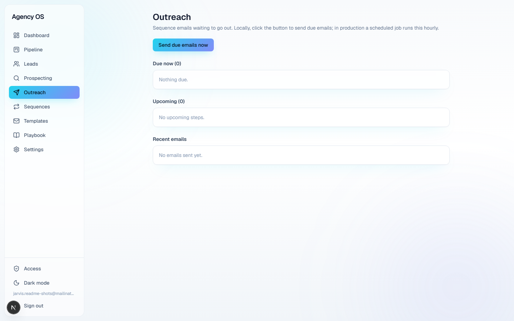
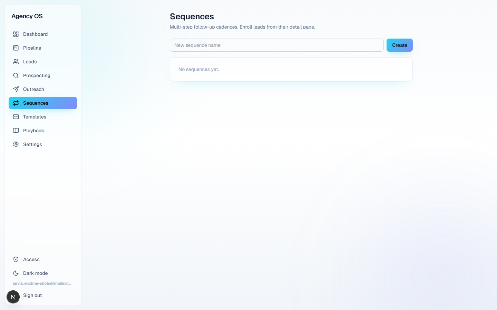
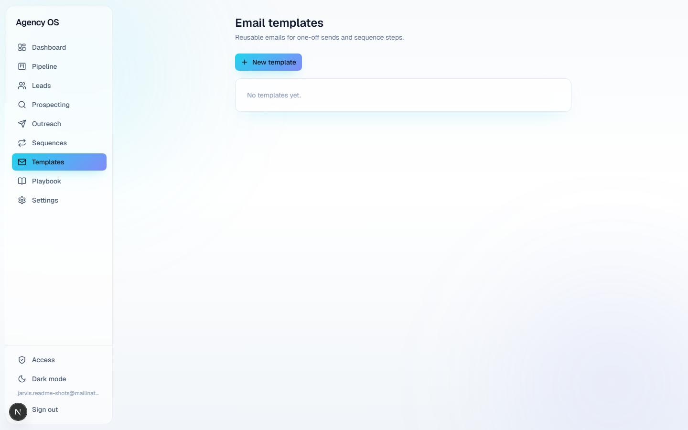
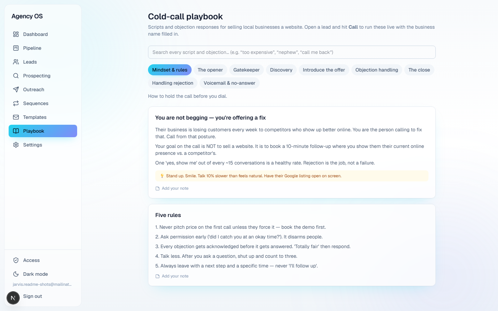
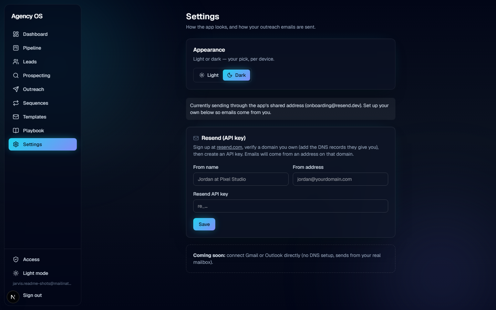
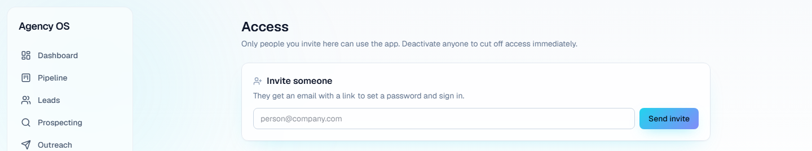

# Agency OS

A self-hosted CRM and prospecting tool built for one workflow: find a local
business with no website, sell them one, and run the whole relationship from
first cold call to closed deal in a single app.

Every business on Agency OS is its own organization, walled off from the
others by row level security, so one install can serve many businesses.
Invite only. A team works the same pipeline, deals, and customers, and each
person sends outreach from their own connected email address.



## What it does

- **Pipeline** — a drag-and-drop kanban board (New Lead → Contacted →
  Interested → Proposal Sent → Won / Lost) with a per-lead activity log.
- **Prospecting** — search local businesses by trade and city through the
  Google Places API, filter to only businesses with no website, and bulk
  import straight into the pipeline.
- **Outreach (email)** — templates with merge fields, multi-step sequences
  with day-delays, and an hourly job that sends whatever's due. Each person
  sends from their own Resend-connected address, with a shared fallback
  address for anyone who hasn't set one up yet.
- **Cold-calling playbook** — mindset, opener, gatekeeper, discovery, pitch,
  searchable objection responses, closing, rejection handling, and
  voicemail scripts. "Call Mode" fills in the script live with the
  business's name and details, and one-click outcome logging updates the
  call log, activity feed, pipeline stage, and follow-up date together.
- **Deals** — quote a lead or customer from the catalog in one tap, mix one
  time and monthly items, and send a single use Stripe payment link. Paying
  it marks the deal won and turns the lead into a customer automatically.
  Changing an item switches the old link off so nobody pays a stale price.
- **Customers and contacts** — businesses or people (a homeowner is a person
  customer), each with contacts, deals, and money won.
- **Catalog** — every service and product with its price, one time, monthly,
  or yearly.
- **Organizations and access** — invite only signup into your organization.
  Owners and admins invite people by email, set roles, and can deactivate
  anyone instantly. Removing someone hands their leads, deals, and customers
  to the admin instead of deleting them.
- **Appearance** — light and dark themes, saved per device.

## Screenshots

| | |
|---|---|
|  |  |
| Pipeline (dark) | Prospecting |
|  |  |
| Outreach | Sequences |
|  |  |
| Templates | Cold-call playbook |
|  |  |
| Settings (dark) | Access (admin) |

## Tech stack

- [Next.js](https://nextjs.org) (App Router, Turbopack) + React + TypeScript
- [Supabase](https://supabase.com) — Postgres, auth, row-level security
- [Resend](https://resend.com) — outbound email
- [Stripe](https://stripe.com) — deal payment links and the payment webhook
- [Google Places API](https://developers.google.com/maps/documentation/places/web-service) — business search
- Tailwind CSS

## Getting started

1. Clone the repo and install dependencies:
   ```bash
   npm install
   ```
2. Create `.env.local` with your own Supabase, Resend, and Google Places
   credentials. For deal payments also set `STRIPE_SECRET_KEY` and
   `STRIPE_WEBHOOK_SECRET`.
3. Run the SQL files in `supabase/migrations/` against your Supabase project
   in order, in the SQL editor (there is no automated migration pipeline).
   On a database that already has users, `0007_organizations.sql` puts them
   all in one organization and makes the first admin its owner.
4. Start the dev server:
   ```bash
   npm run dev
   ```
5. Open [http://localhost:3000](http://localhost:3000). On a fresh install,
   create the first account in Supabase Auth, then create its organization
   in the SQL editor:
   ```sql
   insert into public.organizations (name, slug) values ('Your Business', 'your-business');
   insert into public.organization_members (organization_id, user_id, role)
   select id, '<the new user id>', 'owner' from public.organizations where slug = 'your-business';
   ```
   After that, invite everyone else from the **Access** page.

## Deployment

Built for [Vercel](https://vercel.com). Set every variable from
`.env.local.example` as an encrypted environment variable in the Vercel
project — never commit real keys. The hourly outreach-sending job runs via
the Vercel Cron entry already configured in `vercel.json`.

For deal payments, add a Stripe webhook endpoint at
`https://<your domain>/agency-os/api/stripe/webhook` for the events
`checkout.session.completed` and `checkout.session.async_payment_succeeded`,
and set its signing secret as `STRIPE_WEBHOOK_SECRET`. Only the organization
marked `is_platform` takes payments through your own Stripe key. Other
organizations need their own connected account (Stripe Connect, not built
yet).

## Tests

The database tests run every migration in an in process Postgres (PGlite),
so no Docker or live project is needed. They check that organizations can't
see or touch each other's rows, the backfill, deal totals, and the win and
convert flow.

```bash
npm run test:db
```

The unit tests cover money handling, payment link lines, and the webhook.

```bash
npm test
```
